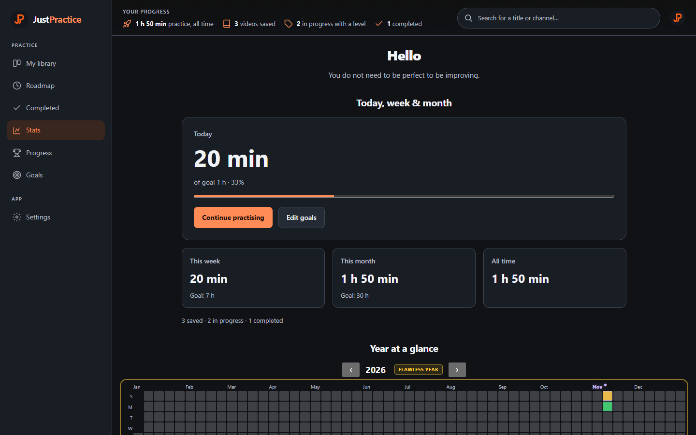
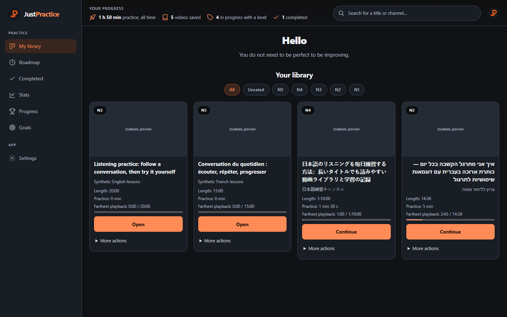
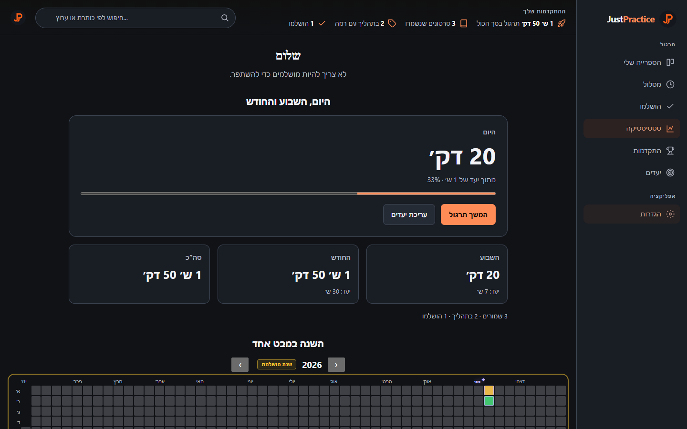

# JustPractice

Language learners can save videos and still lose track of what to revisit and
how much they practiced. JustPractice turns saved YouTube videos into a
practice routine: a local library, JLPT/CEFR/custom difficulty levels and
eligible playback tracked toward a daily goal. Six interface languages include
Hebrew with a right-to-left layout.



*Source candidate 1.0.3, synthetic practice data, November 2026. Screenshots
include the open polish PR stack; the public release can be older.*

**TypeScript · Manifest V3 · Vite/esbuild · Vitest · Playwright · local storage**

[Product website](https://thepoppfish.github.io/JustPractice/) ·
[Runtime download](https://github.com/thepoppfish/JustPractice/releases/latest/download/justpractice.zip) ·
[Architecture](docs/ARCHITECTURE.md) · [Privacy/data flow](docs/privacy.html) ·
[Contributing and checks](CONTRIBUTING.md)

## Try it

Download the ready-to-load ZIP above, extract it, open `chrome://extensions`,
enable Developer mode and choose **Load unpacked** on the extracted folder.
`manifest.json` must be at its root. GitHub's automatic source archives need a
build first. [Release notes and versions](https://github.com/thepoppfish/JustPractice/releases/latest).

For the source candidate, use Node **24.15.0** from [`.node-version`](.node-version):

```sh
npm ci
npm run build
```

Load **`dist/`** unpacked in Chrome. `npm run dev` starts the Vite development
server. No backend, account or API key is needed.

## Use it

1. On a YouTube watch or Shorts page, choose **Save to library** in the floating
   panel and optionally select a level. You can also right-click a YouTube video
   link and choose **JustPractice → a level**.
2. A saved video counts while playing in a visible tab. Focus is required by
   default. Pause playback or hide the tab to pause counting. Disabling **Pause
   counting when YouTube loses focus** permits a visible video in an inactive
   window to count; hidden tabs never count.
3. Open the toolbar popup for the library and quick totals; open the dashboard
   for goals, statistics, the daily roadmap and settings. Practice is batched
   about every 30 seconds and flushed on relevant focus/visibility changes.
4. Change language or level framework in **Settings → Language and levels**.
   Other-framework tags remain available as Legacy rather than being erased.



*Synthetic saved videos and thumbnail placeholders; no personal browser data.*

## Engineering worth exploring

- **Concurrent storage writes:** a service-worker transaction queue prevents a
  delayed metadata response from overwriting a newer setting or practice update.
  Network waits stay outside the queue; results merge into the latest matching
  saved-video membership. [Decision and regression tests](docs/ARCHITECTURE.md#engineering-decision-serialize-mutations-merge-after-network-waits).
- **Recoverable mutations:** validated restore uses a recovery journal; failed
  saves retain drafts and expose Retry; library Undo checks for intervening
  edits. The interface acknowledges persistence after a checked response.
- **Four connected surfaces:** shared tokens and localized duration summaries
  connect popup, dashboard, onboarding and the YouTube shadow panel. Keyboard
  semantics, focus restoration and logical layout properties support Hebrew.
- **Reproducible delivery:** runtime-only ZIPs are verified from the dependency
  closure. Linux/Windows PR checks retain installable artifacts and browser traces.
- **Measured payload:** profiling led to a 50.8% smaller standalone watch
  script, with a 350 KiB build budget and retained before/after evidence.
  [Measurements and limits](docs/polish/performance.md).

See [the architecture and source map](docs/ARCHITECTURE.md).

<details>
<summary>See the Hebrew layout</summary>



*Source candidate 1.0.3, synthetic data, November 2026.*

</details>

## Verification

```sh
npm test
npm run lint
npm run typecheck
npx playwright install chromium
npm run test:smoke
```

The source candidate passed **411 unit tests in 58 files** and **18 installed
Chromium scenarios** on 9 November 2026. These are a dated snapshot, not a
guarantee for later edits. [Current CI](https://github.com/thepoppfish/JustPractice/actions)
and [full release checks](CONTRIBUTING.md#required-checks) are authoritative.
Browser cases use disposable profiles, synthetic thumbnails and a minimal
YouTube fixture; [their scope and limits](tests/browser/README.md) are explicit.
The dependency audit has a [documented expiring development-only exception](docs/polish/dependency-review.md).

## Data, backups and keyboard access

Practice data stays in **`chrome.storage.local`** under **`jpPractice`** in this
browser profile. There is no cloud sync or application analytics endpoint.
YouTube metadata, thumbnail and tutorial requests still contact external
services. [Storage, requests, permissions and deletion](docs/privacy.html).

Before uninstalling or replacing a profile, use **Dashboard → Settings → Your
data → Export JSON** and keep the downloaded file safe. Restore checks
recognized exports up to 8 MB and previews their contents before confirmation.
Its temporary session recovery copy is not a permanent backup. Failed edits
stay in page memory; copy unsaved drafts before refreshing after an update.

Use Tab to reach controls, arrows for onboarding choices and popup tabs, and
Home/End in popup tabs and calendar navigation. Enter opens a calendar month.
The watch panel's move handle supports arrows and Shift for larger steps.
Reduced motion keeps the setup greeting still. The spoken screen-reader check
is tracked separately from automated accessibility results.

## Limits and next steps

Chrome's unpacked-install flow is required; this project is not currently
distributed through the Chrome Web Store. YouTube layout changes, unavailable
metadata, live streams, ads and browser shutdown timing need ongoing real-world
testing. Uninstalling loses the browser's local extension data.

The [21-item polish tracker](docs/polish/README.md) distinguishes merged fixes,
open PRs and outstanding acceptance checks. A [normal-Chrome playback run](docs/polish/live-playback-result-2026-11-10.md)
verified ten-minute tracking and reload persistence; sustained live responsiveness
remains pending. The maintainer skipped the manual screen-reader check. Automated
Chromium service failures are recorded separately from controlled measurements. Historical
planning/audit snapshots are indexed separately in [the docs guide](docs/README.md).

Released under [GPL-3.0-or-later](LICENSE).
