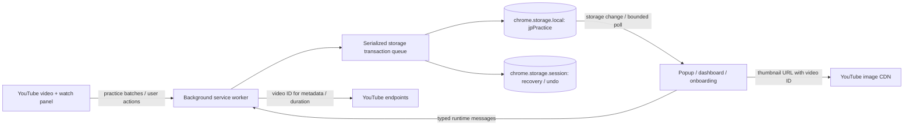

# How JustPractice works

JustPractice is a TypeScript Manifest V3 Chrome extension. Vite builds the
popup, options dashboard and onboarding pages; a separate esbuild step emits
one self-contained YouTube content script, including its shadow styles. There
is no application backend or user account.

## Tracking and data ownership

The content script samples eligible saved-video playback. Hidden tabs do not
count; focus is also required by default. Practice is batched approximately
every 30 seconds and flushed on relevant visibility/focus transitions. It
reports elapsed practice and playback progress rather than uploading video
content. Background validation rejects ticks that no longer refer to an
eligible saved-video membership. Practice history, difficulty levels, goals,
roadmap state and XP live in one versioned local record; schema migration is
part of reading that record.

Start with [the content runtime](../src/content/youtubeWatchPanelRuntime.ts),
[message handling](../src/background/backgroundMessageHandlers.ts) and
[the persisted schema](../src/lib/storageTypes.ts). Practice policy and
aggregation helpers have unit tests beside their source files.

## Engineering decision: serialize mutations, merge after network waits

A settings edit and a delayed metadata request can both read the same snapshot.
If each later writes its whole copy, the slower operation can erase the faster
one. [storage.ts](../src/lib/storage.ts) owns a service-worker transaction queue.
Every persistent practice-data writer uses that queue. Each mutation reads the
latest record and writes while holding its turn; a rejected operation releases
the queue so later work can still proceed.

Network requests stay outside the transaction. On returning, metadata handlers
read again and merge only fields that have not since changed. The saved entry's
membership token/date prevents a response for a removed video from changing a
new save of the same YouTube ID. This prevents lost local updates without
blocking settings behind slow network requests. The queue is process-local;
the design depends on routing persistent writers through the service worker.
It is not a distributed transaction or a general database lock.

See [race regressions](../src/background/backgroundStorageRace.test.ts),
[queue/storage tests](../src/lib/storage.test.ts),
[metadata merge](../src/background/backgroundOEmbed.ts) and
[duration merge](../src/background/backgroundDurationEnrich.ts).

## Recovery and interface consistency

Restore validates a recognized, bounded export before confirmation. A
session-storage recovery journal holds the previous snapshot while replacement
runs. Writes happen before stale keys are removed; an interrupted service
worker recovers the journal before the next transaction. Session storage is
temporary, so this is not a substitute for a user-held backup across a browser
restart or uninstall. [Recovery implementation](../src/lib/storageRecovery.ts).

Checked runtime responses drive pending, success and retry feedback. Page-memory
drafts and focus survive storage-driven repaints; library Undo uses a temporary
session record and rejects conflicts with newer edits. This keeps failed writes
visible without claiming that a draft has been persisted.

Shared CSS tokens and a localized duration formatter connect the four surfaces.
Logical layout properties, directional text isolation, native controls and
focus restoration support Hebrew and keyboard use. Automated accessibility
checks supplement visual review; the separate spoken-reader check is recorded
honestly in [the tracker](polish/index.html).

## Validation and limits

Vitest covers storage races, migration, practice policy, goals, recovery and UI
helpers. Playwright loads the production extension into disposable Chromium
profiles and exercises English/Hebrew setup, mutations, Retry, Undo and shared
styles. Watch fixtures and synthetic thumbnails make failures reproducible;
they do not prove compatibility with every live YouTube layout, ad, stream or
account state. [Browser scope](../tests/browser/README.md).

Runtime packaging walks the manifest/HTML/JS dependency closure, excludes source
maps and development files, and verifies a root manifest. Linux/Windows CI
produces review artifacts; publishing is a separate maintainer action.
[Contributor and release commands](../CONTRIBUTING.md).

The watch entry remains one classic script, with minified JavaScript and embedded
CSS. Its locale loader omits dashboard/onboarding namespaces; shared calendar
messages have their own namespace, and a build guard rejects page-only message
references in the content dependency graph. Extension pages retain the full
dictionaries. Focused D3 imports preserve the celebration without loading the
umbrella package. CI checks the watch payload against a 350 KiB budget; manual
profiling tools retain timing, CPU and memory evidence separately from CI.
